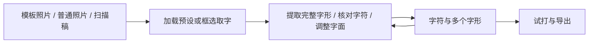

# 字记是工具

更新：2026-10-08。产品定位；功能范围仍以 [roadmap.md](roadmap.md) 为准。改产品时以本文为约束。

## 先把工具做好

字记首先是一个 **本地制字工具**：帮一个人从多种素材中提取字形，打磨字面大小与位置，收进同一份字体，试打并导出。作品集里它作为「产品 + UI」出现，依据是 **好不好用**，不是好不好看、像不像工房。

当前阶段从跑通流程转为重点打磨。成功标准：不需要讲解也能走完 **来源 → 转化 → 管理 → 试打导出**。每一步都知道下一步做什么、现在卡在哪、做完会得到什么。

纸与墨、字柜、灯箱这些说法只描述这件工具的工作对象（纸、字形、样张）。它们不是另一套品牌工程，也不能压过任务本身。好看和材质排在好用后面；两者冲突时改交互，不先换皮肤。

## 它是什么

本地、单人、一份字体。用户在本机持续完善同一份字体。产品对象是那份正在长出来的手写字体。字符库、模板、照片批次都是材料，不是并列产品。一份字体的工程约束见 [`.cursor/rules/single-font.mdc`](../.cursor/rules/single-font.mdc)。

## 来源、转化、管理

- **来源允许多元。** 指定模板提供区域与字符预设，通用模板提供区域预设，普通照片与扫描稿直接框选取字。模板是可选的采集工具。
- **转化统一结果与操作顺序。** 预设加载出来后允许修改，也允许新增、删除取字区域；不强迫每种来源重复同样的步骤。核对字符、等比缩放、字面占框比例与位置调整是核心工作，原始轮廓保留。
- **管理围绕同一份字体。** 字符组织多个字形，用户比较、选用和继续调整。来源与转换批次用于追溯；不以一套模板对应一套字体，不增加多字体项目体系。
- **试打参与打磨。** 从段落效果返回字形修正，修正后重新生成字体。

当前不涉及部首拆分、笔画重组和自动补字。普通照片第一步采用用户框选完整字形；自动切字与 OCR 尚未实现。

## 它不是什么

- **不是 SaaS。** 没有组织、席位、账单、多项目。不要为了「像产品」去加侧边栏和仪表盘。
- **不是营销页或个人站。** 工作界面就是产品。Observatory 承担作者声音；字记只保留笔形成标这一处签名。
- **不是视觉练习。** 不要为作品集另做皮肤，也不要把工房气质做成装饰。

## 好用优先于样子

当前阶段只问这几件事：

1. **下一步明确。** 字符库、模板、照片、校正、试打各自的主操作一眼能看见；少靠长 hint 解释流程。
2. **对象就是工作面。** 字、纸、照片、样张占主面积，控件让路。模板画布（`.studio`）是参照：那是在做事，不是在填表。
3. **状态可读。** 未写、已有字形、待核对、未定稿、导出过期，用工作对象上的状态表达，不堆后台标签。
4. **手艺在操作里。** 选择、吸附、校正滑杆、核对切字，比换色更决定好不好用。
5. **空状态能开工。** 用空格纸、待写字符、待拍的页说话，少用「还没有…」。

## 视觉仍收敛（为工具服务）

需要动外观时：暖纸色与墨黑 `#11110f`；朱砂红只用于危险和极少数定稿/导出；界面与印刷同一字族（IBM Plex Sans SC）；chrome 薄；暗色是关灯的桌子。不要品牌紫、渐变、玻璃拟态、Inter 拼盘。

## 现状差距

现在的问题首先是 **工具感不完整**：模板 studio 和字形编辑已经在做事；字符库、模板库、照片上传更像后台表单，主操作和对象不够大。材质寡淡是次要的。下一步是把各入口做成同一件工具的工作面，而不是先铺一层纸纹。
